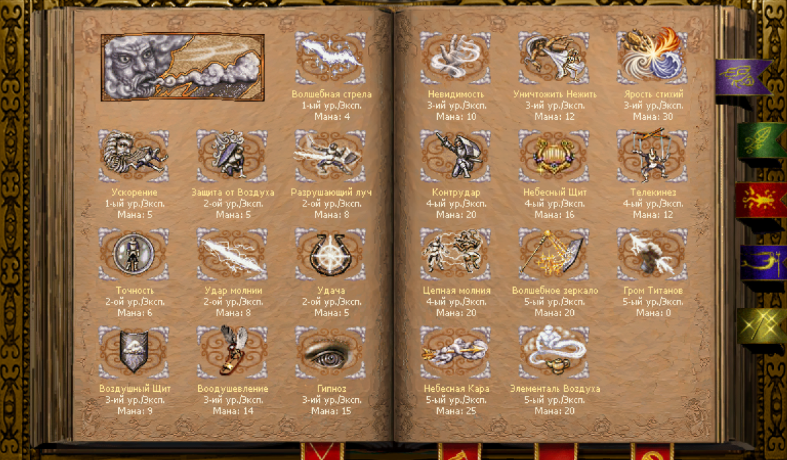
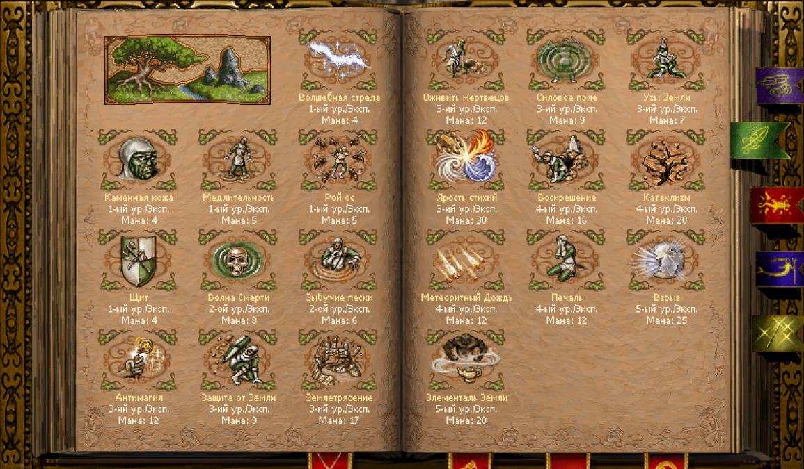
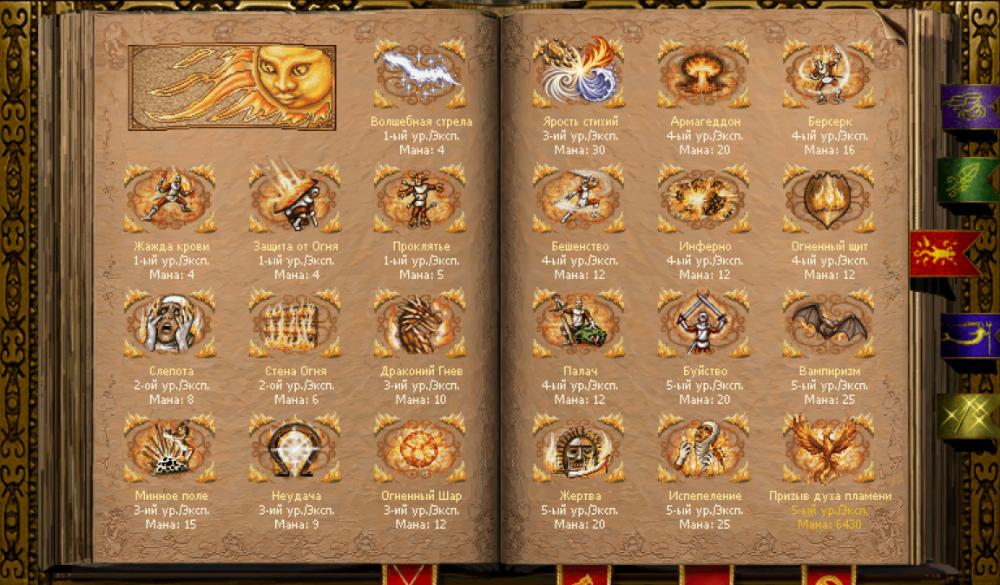
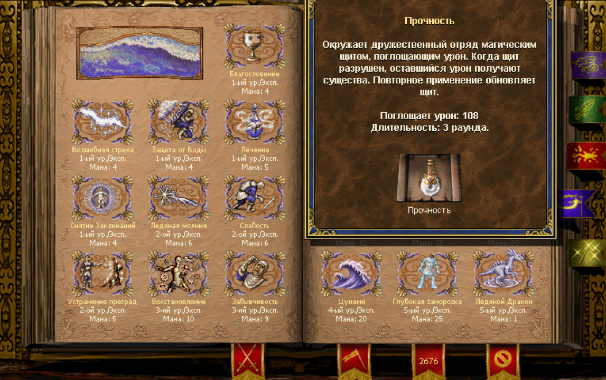
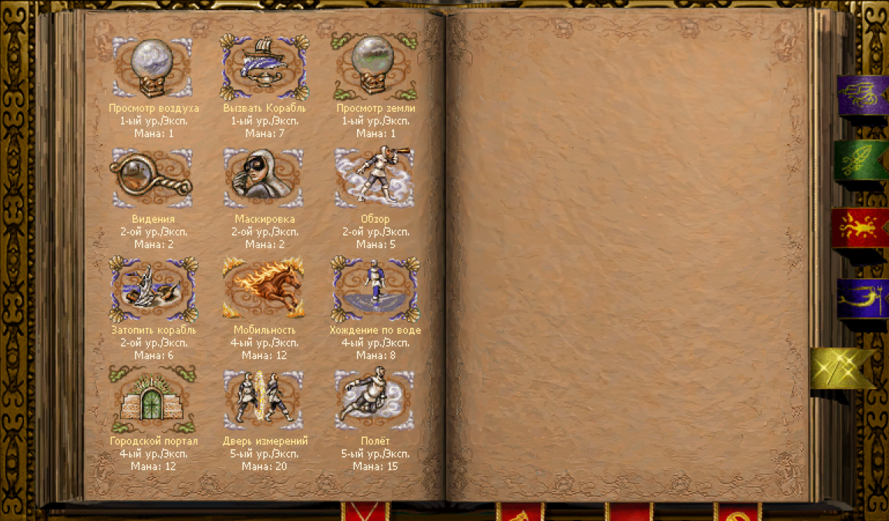
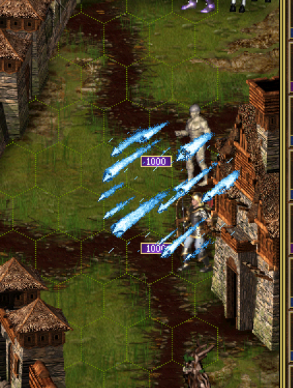

# ERA Spells

Новая боевая магия для Heroes III ERA: урон, контроль, защитные эффекты и призыв существ. Самостоятельный мод от Toxeos с русским и английским языками и поддержкой редактора карт.

## Совместимость

- **GEM**: использует штатный каталог заклинаний; изменять файлы GEM не нужно. Списки исследований, уже записанные в старых сохранениях, не перестраиваются.
- **JS / InstantAnim, TUM / Amethyst**: сборка 0.6 Beta проверена в Complete с включёнными модами; в этой проверке работают Небесный щит и новые иконки эффектов. Amethyst и TUM необязательны.
- **ACM**: включено исправление доступа к описаниям и параметрам заклинаний. Полная игровая проверка Мастера/Грандмастера ещё не завершена; дополнительные механики этих рангов для новых заклинаний не добавлены.
- Требуются **ERA/WoG и ERA Erm Framework**. Не включайте одновременно сюжетный Toxeos или другой мод, заменяющий те же таблицы магии.

## Последнее обновление — 0.7.1

Вампиризм получил выбранную иконку летучей мыши во всех четырёх форматах; механика не менялась.

Четыре новых заклинания, обновлённые иконки и звуки, баланс и компактные описания. Сторонним генераторам доступны актуальные запреты карты через API/SDK.

## Заклинания

- **Метель** — Наносит урон цели и отрядам на соседних клетках, снижая их скорость на 2. Длительность замедления: 2/4/6 раундов по уровню школы; скорость не падает ниже 2.

- **Глубокая заморозка** — Наносит урон и замораживает отряд на 3 раунда. Первый повреждающий удар разбивает лёд: обычная атака наносит 200%, магия Огня — 150%, прочие заклинания — 50% урона.

- **Небесная Кара** — Поражает выбранный отряд мощным разрядом. Если выжившая цель ещё не ходила, она теряет ход в текущем раунде.

- **Катаклизм** — Наносит урон наземным существам обеих армий. Летающие существа и боевые машины не получают урон. Может лишить ещё не ходившие отряды текущего хода.

- **Драконий Гнев** — Повышает Защиту дружественного отряда и делает его предпочтительной целью вражеского ИИ.

- **Воодушевление** — Приближает следующую активацию дружественного отряда. Доступные уровни существ зависят от владения школой магии.

- **Небесный Щит** — Защищает от физического урона, но не от магического. Снимается по истечении срока или после установленного числа попаданий; параметры зависят от владения школой.

- **Буйство** — Временно удваивает прямой урон дружественного отряда, включая ответные удары.

- **Призыв духа пламени** — Призывает существо «Дух Пламени». Его характеристики зависят от уровня героя, силы магии, навыка Огня и живой армии. При гибели или замене он вызывает Инферно. Рост цены маны начинается с 20 уровня героя.

- **Узы Земли** — Создаёт непроходимую преграду из корней. Корни можно разрушить ударами и заклинаниями; их прочность и время существования зависят от владения школой.

- **Испепеление** — Половину урона наносит сразу, оставшуюся половину — частями в начале трёх следующих раундов. Повторное применение заменяет оставшийся эффект.

- **Телекинез** — Перемещает вражеский отряд в пределах 6 клеток, обходя стены и препятствия. Допустимый уровень существ зависит от владения школой.

- **Смятение** — Лишает противника контратак. На Эксперте действует на все подходящие вражеские отряды. Длительность равна Силе магии героя. Успешное «Смятение» снимает «Контрудар»; успешный «Контрудар» снимает «Смятение».

- **Восстановление** — Восстанавливает здоровье машин и големов.

- **Рой ос** — Половину урона наносит сразу, вторую половину — в начале следующего раунда, после чего эффект исчезает.

- **Цунами** — Наносит урон всем вражеским отрядам, кроме боевых машин.

- **Ледяной дракон** — Призывает неживого двухклеточного Ледяного дракона с защитой от магии Воды и Разума. Его прочность измеряется попаданиями. Базовая стоимость — 25 маны. Получение — только ручное назначение, без случайных гильдий и шрайнов.

- **Ярость стихий** — Обрушивает мощь четырёх стихий на выбранный вражеский отряд. Редкое заклинание; не выдаётся книгами стихий.

- **Невидимость** — Скрывает дружественный отряд. Передвижение, входящая или исходящая атака снимают эффект; ожидание и защита сохраняют его. Длительность равна силе магии героя.

- **Обзор** — Временно открывает выбранную область карты до следующего хода владельца; обычная разведка сохраняется.

- **Мобильность** — Даёт 300 очков передвижения. Между повторными применениями в тот же день нужна победа в бою.

- **Прочность** — Щит Воды на 3 раунда: 9 × сила магии + 9/9/18/27 поглощаемого урона.

- **Вампиризм** — Восстанавливает 15/20/25/30% урона; штраф максимального здоровья 25/20/15/10%. Лечение снимает эффект. Восстановление здоровья сопровождается штатным эффектом высасывания жизни вампиров.

## Получение и редактор карт

Заклинания можно вручную назначать героям, гильдиям магов, шрайнам и другим поддерживаемым источникам в ERA Map Editor. Назначения сохраняются в карте. Обычные новые заклинания также встречаются случайно в гильдиях и шрайнах, реже стандартных; правила задаются в `ToxData/spell_generation.tsv`. Ярость стихий имеет отдельный редкий шанс. Призыв духа пламени не генерируется в Оплоте, Башне и Некрополисе. Ледяной дракон и Ярость стихий не выдаются книгами стихий.

## Установка и язык

Установите папку **ERA Spells** в `Mods` и включите мод. Требуются ERA/WoG и ERA Erm Framework. Amethyst и New Spells не нужны. Не включайте одновременно сюжетный Toxeos или другое расширение, заменяющее те же таблицы заклинаний.

Английский — язык по умолчанию. Для русского выберите `ru` в настройках ERA или укажите `Language=ru` в секции `[Era]` файла `heroes3.ini`. Для английского используйте `Language=en`. Перезапустите игру и редактор.

## Для авторов плагинов

[Read-only API запретов и SDK](Developers/SpellIntegration/README.md) дают актуальный запрет карты для обычных и новых заклинаний. Старое поле на 70 заклинаний не покрывает расширенный каталог. Включены заголовок C++ и пример; собственные фильтры школы, редкости и типа объекта остаются у генератора.

## Скриншоты

## Авторы

Автор мода — **Toxeos**.

Помощь с графикой — **Dalion** и **Toriko**.

Вы можете изменять мод и делиться своими версиями.

[История версий](https://github.com/toxeanubis1994-arch/ERA-Spells/blob/main/CHANGELOG.ru.md) · [Скачать 0.7.1](https://github.com/toxeanubis1994-arch/ERA-Spells/releases/tag/v0.7.1)

